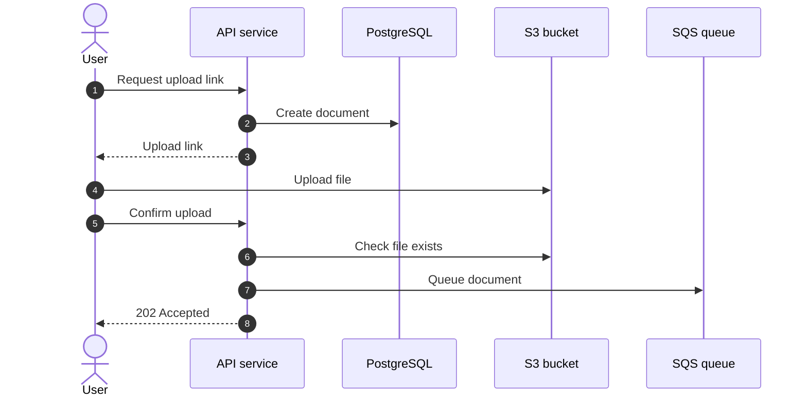
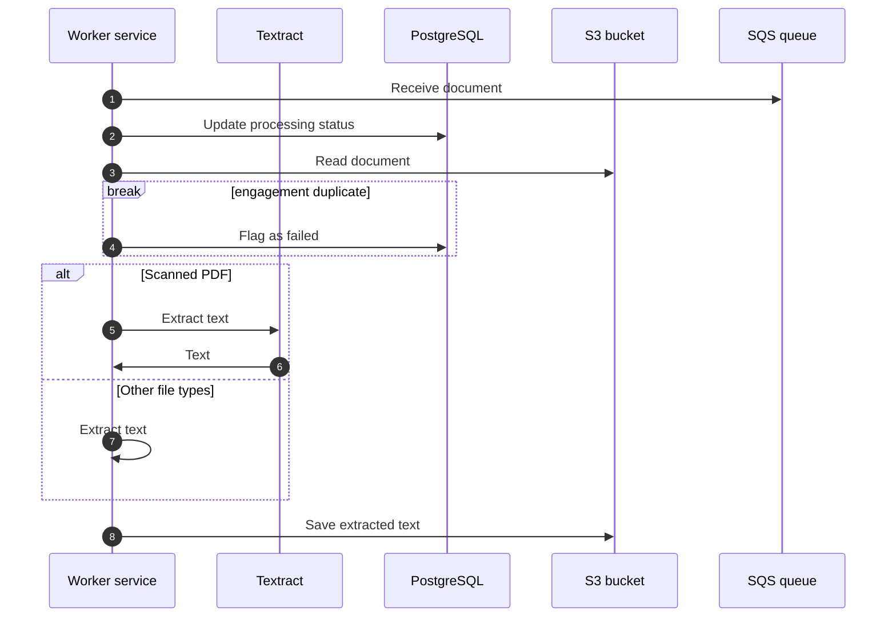
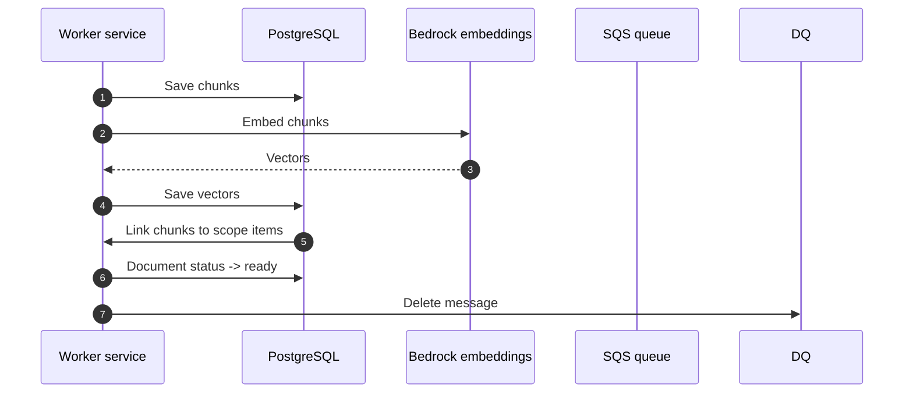
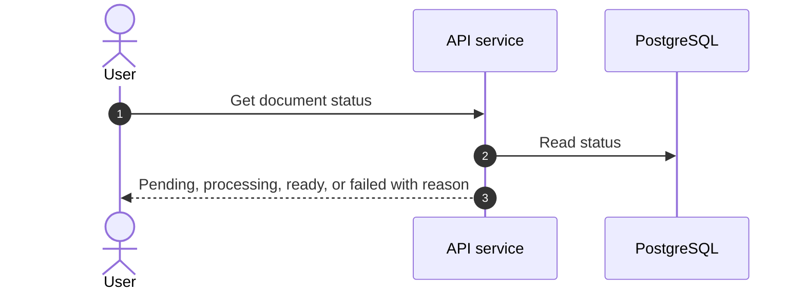
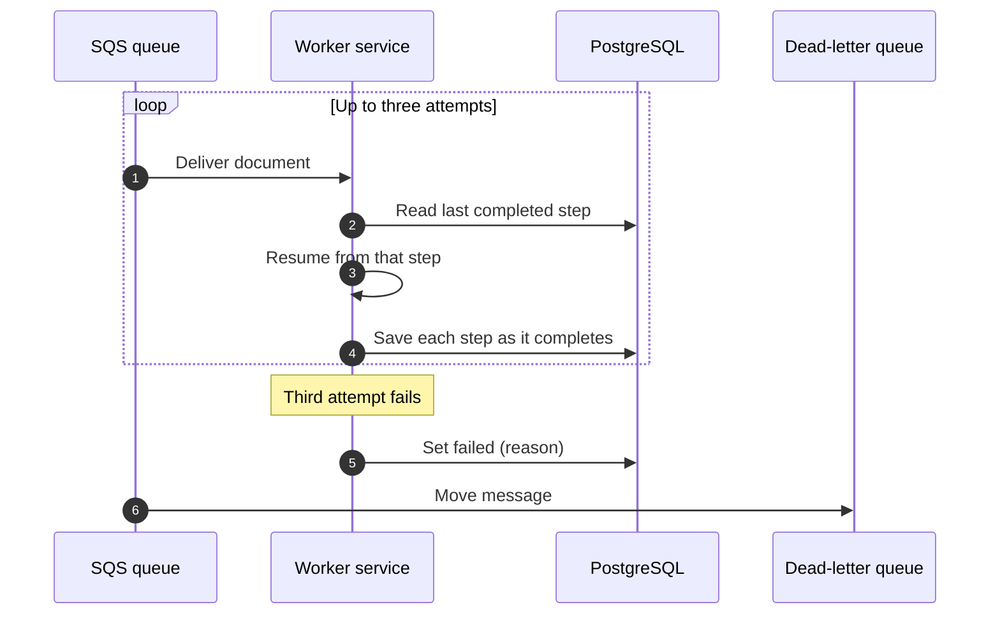
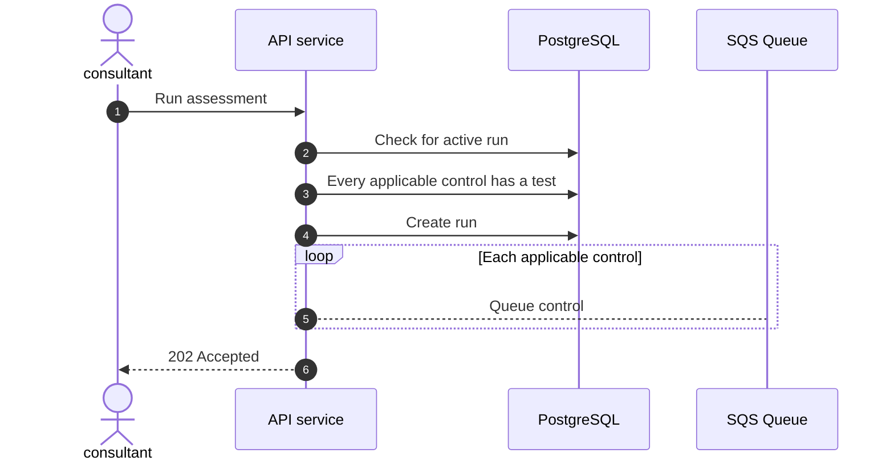
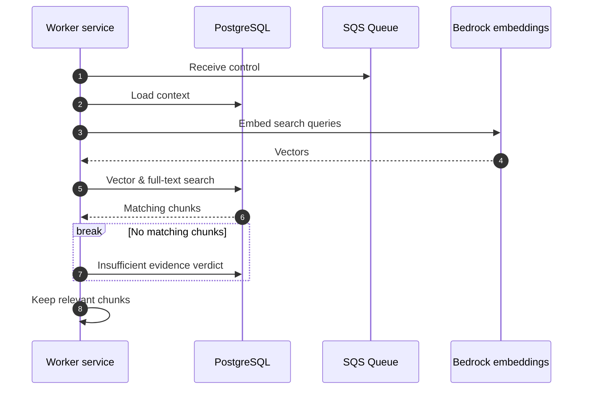
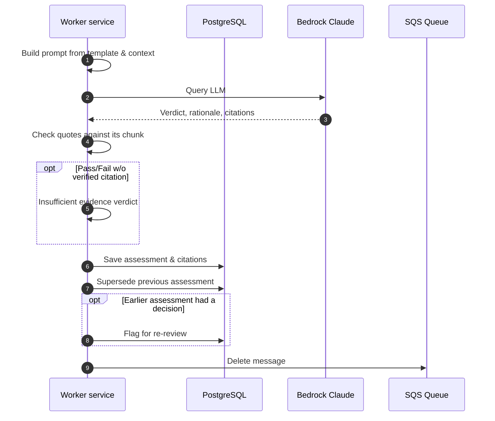

# Compliance Backend

Backend system to facilitate audits via AI-assistance. 

Primary Offering:

1. New client onboarded.
1. Works with consultant to define frameworks, scope, and controls.
1. Client uploads evidence documents.
1. AI determines presents it verdicts and evidence on a per-control basis.
1. Auditors review the findings and evidence to provide the final say on a per-control basis.
1. Report generated according to firm-provided DOCX template.


The primary feature enables clients and consultants to upload evidence documents, the system assesses each control against that evidence. It presents the preliminary verdict, reasoning, and cited evidence to the consultant who makes the final decision.

## Tech stack

| Concern | Choice |
|---|---|
| Language and runtime | C# on .NET 10 |
| Web framework | ASP.NET Core minimal APIs |
| Background work | Hosted services in the same application |
| Database | Amazon Aurora PostgreSQL with pgvector |
| Data access | EF Core with Npgsql |
| File storage | Amazon S3 |
| Queues | Amazon SQS + DLQs|
| Language model and embeddings | Claude and Titan Text Embeddings V2 through Amazon Bedrock |
| Text recognition | Amazon Textract, for scanned PDFs |
| Sign-in | Amazon Cognito w/MFA |
| Hosting | Amazon ECS on Fargate |
| Infrastructure | AWS CDK in C# |
| API reference | OpenAPI document + Scalar browser |
| Tests | xUnit, Testcontainers |

## Project structure

```
ComplianceBackend.sln
Directory.Build.props        shared build settings for every project
DECISIONS.md                 hard-to-reverse design choices
docs/                        generated files; never edit by hand
src/App/                     the application: API and worker in one project
  Program.cs
  Features/                  one folder per feature: endpoints, request types, service
  Pipeline/                  queue consumers and document processing steps
  Integrations/
    Abstractions/            interfaces the rest of the code depends on
    Aws/                     S3, SQS, Textract and Bedrock implementations
  Data/                      DbContext, entity configurations, migrations
  Common/                    sign-in, access checks, errors, paging
tests/App.Tests/             unit and integration tests
infra/                       CDK project
```

Folders are created when their first file is added.

## Architecture

The backend application is a single application image that may run as two services. The first service is the Rest API service. This service provides responses to HTTP requests. The second service is the Worker service. This service handles the backend processing of files and queues.

### Document Sequence Diagrams

#### Upload



#### Text Extraction



#### Indexing


#### Status Check



#### Retries


### Assessment Sequence Diagrams

#### Starting run


#### Evidence search


#### Preliminary verdict


#### Run completion
``` mermaid
```

#### Consultant review
``` mermaid
```

#### Evidence changes
``` mermaid
```

#### Results
``` mermaid
```

**Rules the code keeps:**
- All data belongs to one engagement, and every query filters by it.
- Assessments and consultant decisions are never edited. A new run or decision adds a row.
- Code outside `Integrations/Aws/` uses only the interfaces in `Integrations/Abstractions/`.

## Build

Prerequisites:
- Visual Studio 2026 with the "ASP.NET and web development" workload, or the .NET 10 SDK with another editor
- Docker Desktop, for the local database and integration tests

In Visual Studio:
1. Open `ComplianceBackend.sln`.
2. Set `App` as the startup project and press F5.
3. Open `/health` to check the service is running, and `/scalar` to browse the API.

From a terminal at the repository root:

```
dotnet build
dotnet run --project src/App
```

## Test

Start Docker first: integration tests run PostgreSQL in a container.

In Visual Studio, open **Test > Test Explorer** and choose **Run All**. From a terminal:

```
dotnet test
```

Each test declares the requirement it proves with a `[Requirement("ID", "text")]` attribute. A requirement that isn't built yet is a skipped test, so a skipped test is pending work, not a failure.